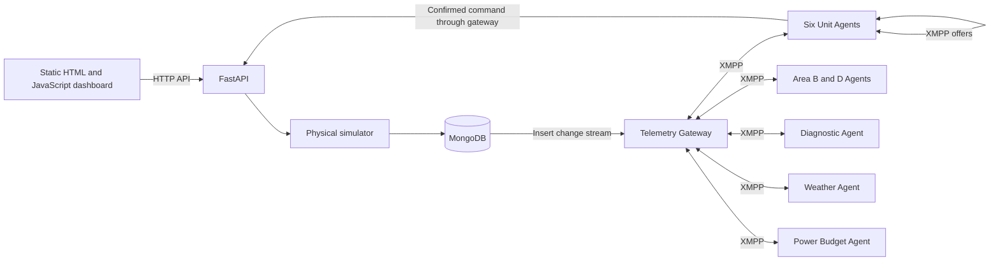

# Smart Building HVAC Multi-Agent System

A simulation and evaluation backend for the MSc Software Agents and Swarm Intelligence assignment. Four business areas contain six independently controlled zones, each with its own thermostat and rooftop HVAC unit. Twelve SPADE agents communicate over XMPP to manage comfort, shared electrical capacity, negotiations, and diagnostics.

## Run locally

From the repository root with Python 3.12:

```sh
python3.12 -m venv .venv
source .venv/bin/activate
python -m pip install -e '.[test]'
cp -n .env.example .env
```

Set `MONGODB_URI` in `.env` to your MongoDB Atlas connection string. Atlas provides a replica set or sharded cluster, which supports the change streams this system uses. The application creates its collections and indexes when it starts. Docker is not part of the agent workflow; SPADE starts its embedded XMPP server by default.

From the backend folder, run `./scripts/dev.sh` to start the API and SPADE runtime together. To run the services separately, use two backend terminals:

```sh
# Terminal 1, from HVAC_MAS_SYS
source .venv/bin/activate
uvicorn hvac_mas.api.main:app --host 127.0.0.1 --port 8000

# Terminal 2, from HVAC_MAS_SYS
source .venv/bin/activate
python -m hvac_mas.runtime

```

Set `CORS_ORIGINS=http://localhost:5173,http://127.0.0.1:5173` in the backend `.env` for browser access. The frontend reads `VITE_API_URL` from its own `MAS_FE/.env` during its build; see [`../MAS_FE/README.md`](../MAS_FE/README.md).

The static dashboard is a separate frontend project in [`../MAS_FE`](../MAS_FE/README.md). It talks to this backend over HTTP, so the projects can be deployed independently. Start the API and agents with `./scripts/dev.sh` from `HVAC_MAS_SYS`, then build and serve the dashboard from `MAS_FE` as described in its README. The dashboard is at [http://127.0.0.1:5173](http://127.0.0.1:5173), and the API docs are at [http://127.0.0.1:8000/docs](http://127.0.0.1:8000/docs). The simulation starts paused. Backend logs go to `results/logs`. Press Ctrl+C to stop the backend processes. If using the project-local environment already set up on this Mac, run `HVAC_PYTHON=.venv312/bin/python ./scripts/dev.sh` from `HVAC_MAS_SYS`.

To run the physical simulator and XMPP agents without MongoDB, use `STORAGE=memory ./scripts/dev.sh`. Memory mode exercises the same controller with an in-process repository and the API handoff supplies observations to the gateway. Use Atlas mode to demonstrate persistence, change streams, and database TTL.

If startup reports that the MongoDB DNS lookup timed out, reconnect or try another network and run the same command again. If the network consistently fails to resolve your `mongodb+srv://` URI, open Atlas **Connect → Drivers**, turn off **SRV Connection String**, and copy the complete standard `mongodb://` URI into `MONGODB_URI` in `.env`. Keep the hosts and connection options Atlas supplies. [Atlas connection troubleshooting](https://www.mongodb.com/docs/atlas/troubleshoot-connection/)

## Deploy the backend

Deploy this repository as two long-running Python services on a host that supports web services and background workers. For an Oracle Cloud Ubuntu VM deployment, follow [`deploy/oracle/README.md`](deploy/oracle/README.md). The current API and agent handshake uses in-process coordination, so run one API instance and one worker.

| Service | Install command | Start command |
| --- | --- | --- |
| FastAPI web service | `pip install .` | `uvicorn hvac_mas.api.main:app --host 0.0.0.0 --port $PORT` |
| SPADE worker | `pip install .` | `python -m hvac_mas.runtime` |

Set `DEPLOYMENT_MODE=hosted`, `STORAGE=mongo`, `MONGODB_URI`, `MONGODB_DATABASE`, `RUNTIME_TOKEN`, and `EVALUATOR_TOKEN` on both services. Generate each key separately with `openssl rand -hex 32`. Give the evaluator only the evaluator key and schedule one authorized demonstration at a time on the shared simulation. Set the worker's `API_URL` to the deployed API's base URL. Set `CORS_ORIGINS` on the API to the frontend site's exact origin. Keep Atlas and runtime credentials in the host's secret environment settings. Do not deploy the current FastAPI entry point as a serverless function: see [the deployment architecture](docs/deployment.md).

## Dashboard features

The separate static dashboard in [`../MAS_FE`](../MAS_FE/README.md) reads live API state and evidence. It shows six room agents, decisions, power allocation, temperatures, messages and diagnostic events. It can start scenarios, advance or run the simulator, launch live experiments, schedule equipment faults and environment changes, and export a run. The system is configured for one shared run and one live experiment at a time.

## Architecture and control



| Agent | Performance objective | Sensors and knowledge | Actions |
| --- | --- | --- | --- |
| Unit | Maintain local comfort and limit switching or excess demand | Local thermostat and equipment observation, forecast, supported and feasible stages, waiting history | Stage request, peer offer or concession, actuator command |
| Area | Coordinate comfort across B or D | Member occupancy and temperature, diagnostic notices | Local priority advice and recovery status |
| Power | Maintain a feasible electrical allocation | Discrete requests, current physical constraints, building cap | Reserve, validate swaps, finalize one interval |
| Diagnostic | Identify persistent equipment and comfort problems | Timestamped telemetry, equipment ratings, diagnostic thresholds | Candidate, confirmation, recovery and resolution notices |
| Weather | Share outdoor conditions consistently | Seeded weather profile and configured overrides | Current observation and one-hour forecast |
| Gateway | Route the right observation and decision to the right participants | Run/step manifest, MongoDB inserts, agent replies | XMPP observations and commands to the backend |

The simulator uses five-minute steps. Envelope transfer, occupancy gains and equal-and-opposite flows between B1/B2 and D1/D2 determine zone temperatures. Each RTU conditions only its own zone. Supply temperature is estimated from sensible output, airflow, air density and specific heat. The model uses °C internally and °F on telemetry and dashboard boundaries. Stage ratings, thresholds and thermal parameters are synthetic and configurable.

Occupancy is tracked independently for each zone. Scenario schedules provide the baseline; persistent overrides and timed temporary groups are applied on top. The dashboard's **Change room occupancy** control can record arrivals, departures, transfers, one-off room totals, and temporary groups, or restore the scenario schedule. Occupancy above a zone's design count is accepted, flagged in the room view, and included in physical occupant heat gains. The shared comfort policy confirms vacancy before using unoccupied setpoints and can precondition toward the next scheduled arrival. Telemetry includes the effective target range, occupied targets, and occupancy state. FAN circulates air without adding heating or cooling capacity.

Unit Agents forecast comfort over the configured horizon using expected scheduled occupancy, outdoor conditions, local thermal properties, and available neighbouring-zone temperatures. Their intents include ranked alternatives, projected temperatures, occupancy ratios and decision signals. Area Agents summarize occupancy, temperature deviation, available equipment and potential concessions. The Power Agent protects required FAN/equipment loads and checks bilateral or multi-donor concessions atomically against the shared cap. Decisions and area summaries are recorded with the interval evidence.

The same occupancy actions are available through `POST /environment/change`, for example:

```json
{"occupancy_actions":[{"kind":"temporary_add","zone_id":"B1","count":5,"duration_minutes":30}]}
```

Action kinds are `set`, `arrival`, `departure`, `transfer`, `temporary_add`, and `restore_schedule`. Transfers specify `source_zone_id`, `destination_zone_id`, and `count`; other actions use `zone_id`. All changes apply at the next simulation interval.

A simulation interval applies scheduled disturbances, writes observations, waits for valid agent decisions, applies a feasible command batch, and advances the plant. The backend checks both stage safety and electrical power against the reservation. The Power Budget Agent serializes assignments and uses a version to reject stale swaps. Each bilateral SPADE state machine uses a bounded number of proposals. Confirmed terms apply for one simulation interval. On a live decision timeout, the backend records a fallback and chooses feasible stages. Experiment runs reject timeouts so timing failures do not enter controller comparisons.

The change stream checkpoints after validated ingestion into the gateway buffer. Restart reconciles unexpired observations, and the active manifest constrains dispatch to the intended run, interval, and packet IDs. Diagnostics evaluate one observation per unit and step, without access to physical fault truth. G2 and G5 are configurable academic thresholds and their qualification includes persistence and recovery monitoring.

## Verification

```sh
python -m pytest -q
```

With the app running against a **disposable** local database, export the same connection settings as the backend and run:

```sh
python scripts/check_integration.py
```

The integration check creates synthetic runs and a uniquely named short-TTL probe collection in the selected database. Run it only against a disposable database. The scenario evidence, assumptions and remaining verification limits are recorded in [verification.md](docs/verification.md).

### Watching the backend and agents

Start the local services from this directory:

```sh
HVAC_PYTHON=.venv312/bin/python ./scripts/dev.sh
```

The launcher shows both services in the terminal and also saves `results/logs/backend.log` and `results/logs/agents.log`. It refuses to start a second API or embedded XMPP server on occupied ports.

```sh
tail -f results/logs/backend.log results/logs/agents.log
```

At INFO level, look for `API_READY`, twelve `AGENT_STARTING` lines, `AGENTS_READY count=12`, and `RUNTIME_HEALTH`. Each interval logs `INTERVAL_STARTED`, `DECISION_STARTED`, `INTERVAL_COMMITTED`, and six `UNIT_DECISION` lines with requested/applied stages and demand reason codes. `AGENT_EVENT` reports diagnostic and negotiation outcomes; `INTERVENTION_QUEUED` and `INTERVENTION_APPLIED` connect edits to their accepted/committed step. A missed deadline emits `AGENT_DEADLINE_MISSED` and a `fallback` outcome. Failures emit `INTERVAL_FAILED`, `AUTOPLAY_STOPPED`, or `EXPERIMENT_FAILED`.

Set `LOG_LEVEL=DEBUG` for per-message routing logs (`MESSAGE_SENT`); INFO stays readable. Raw XMPP payload logging is suppressed to avoid exposing credentials. Connection/readiness and successful commits are different checks: a connected agent team can still miss a deadline, and a committed action does not by itself establish scientific claims about emergence or optimal comfort.

See [dashboard API semantics](docs/dashboard-api.md) for scheduling, interval metrics and evidence identifiers.
