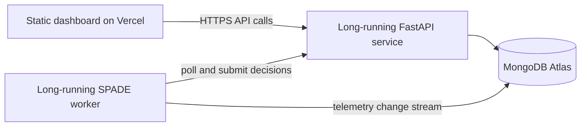

# Hosting architecture review

## Recommended deployment

Build `MAS_FE` and publish its `dist/` output as a static Vercel site. Deploy `HVAC_MAS_SYS` as a long-running API service and one background worker, with MongoDB Atlas as the shared database. Docker is not required. SPADE starts its embedded XMPP server inside the worker by default.

For an Oracle Cloud Ubuntu VM deployment, see [`../deploy/oracle/README.md`](../deploy/oracle/README.md).

Vercel serves the static front end. Vercel Functions have finite execution durations and are not a suitable host for this continuously running SPADE worker. Use a host with long-running web and worker services for the backend. See [Vercel Functions limits](https://vercel.com/docs/functions/limitations) and [Render background workers](https://render.com/docs/background-workers).

## Current backend limits

- The physical run snapshot is persisted in MongoDB after every committed interval and restored when the API starts. Older telemetry, actions, messages, events, and experiment reports are also stored in MongoDB with bounded retention.
- An in-progress decision uses an in-process future (`Service.pending`), and an experiment runs as an in-process asyncio task. Keep one API instance and one SPADE worker; do not horizontally scale the API or move it to a serverless function without replacing this coordination with durable jobs.
- The demo has one shared live run and one active experiment. Concurrent users would act on the same state. The current requested single-user deployment can use this model.
- Public control endpoints do not authenticate callers. `CORS_ORIGINS` limits browser origins but is not access control. If the site is reachable by the public, add host-level access control or API authentication and request limits before inviting unrestricted users.

## Deployment settings

Set `STORAGE=mongo`, `MONGODB_URI`, `MONGODB_DATABASE`, `RUNTIME_TOKEN`, and `XMPP_EMBEDDED=true` on both backend services. On the worker, set `API_URL` to the API service's HTTPS base URL. On the API, set `CORS_ORIGINS` to the exact Vercel origin. In the Vercel project, set `VITE_API_URL` to the public API base URL. Keep secrets in the host's protected environment settings and out of both repositories; `VITE_API_URL` is public client configuration, not a secret.
